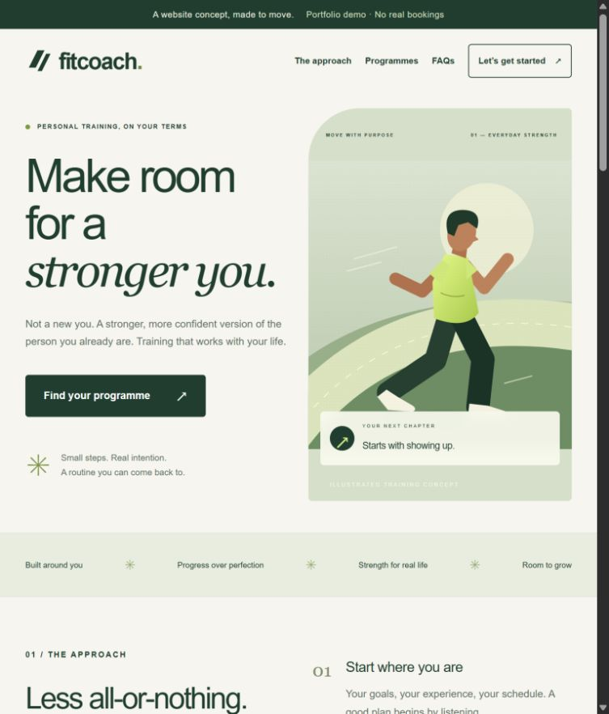

# FitCoach — personal training website concept

A responsive, English-language landing page built as an independent portfolio demonstration with substantial Codex assistance. This is not a real client project or a coaching service. Prices, programmes and the weekly routine are illustrative; there are no fabricated testimonials or customer outcomes.



## Features

- Original SVG runner illustration, editorial typography and a green/lime visual system.
- Responsive layouts and a mobile navigation menu.
- Three programme cards that preselect the enquiry form.
- Native keyboard-accessible FAQ disclosures.
- Client and server validation, inline errors, submission lock and retry handling.
- Local-only Node.js enquiry endpoint with bounded request size and same-site origin allowlist.
- File-backed demo persistence and request IDs that prevent repeated sequential submissions from creating duplicates.
- No third-party tracking, remote fonts, paid services or required secrets.

## Run locally

Requires Node.js 24+ and pnpm. Versions are pinned in package.json and pnpm-lock.yaml.

```sh
pnpm install --frozen-lockfile
pnpm dev
```

Open http://127.0.0.1:3100. For a production preview:

```sh
pnpm build
pnpm start
```

On the original Windows workstation, `Start-FitCoach.ps1` also locates the bundled Node runtime. It does not install software or publish anything. Keep its terminal open while viewing the site; Ctrl+C stops the server.

## Checks

```sh
pnpm test
pnpm typecheck
pnpm build
pnpm audit --prod
# With the local server running:
node tests/api.mjs
```

Unit tests use Node's built-in TypeScript stripping. HTTP integration tests use synthetic example.com addresses and intentionally create demo records.

## Demo form and data

Use fictional data only. POST /api/enquiries accepts name (2–80 characters), email (up to 254), programme (Foundation/Build/Personal), message (10–1,000), consent=true, an empty website honeypot and a UUID-v4 requestId. Requests above 8 KiB are rejected. Only localhost/127.0.0.1 on port 3100 are allowed browser origins.

Accepted requests are saved in `.data/enquiries/<requestId>.json`. The UI says: **Demo request saved locally; no email sent.** This directory and `.test-data/` are ignored by Git. Never add them to a public repository. No email provider, calendar booking, account system or payment system is connected.

This is a single-machine demonstration, not a production lead database. There is no distributed rate limiter or authenticated administration. File storage is unsuitable for ephemeral/serverless hosting and does not provide database-grade concurrent transaction guarantees. Public deployment requires separate approval and replacement of this storage, retention/access policies, abuse controls, a production origin configuration, and a real email provider if needed. Do not collect real personal details in this demo.

## Structure

- `app/page.tsx` — landing page and interactive form.
- `app/globals.css` — visual system and responsive breakpoints; Tailwind v4 integration.
- `app/api/enquiries/route.ts` — request parsing, origin/type/size checks and response handling.
- `lib/enquiry.ts` — shared validation and types.
- `lib/store.ts` — local demo persistence.
- `tests/` — validation/storage tests and live HTTP checks.
- `docs/` — case study, QA notes and screenshots.

## Accessibility and security

Semantic headings and landmarks, skip link, labelled controls, visible focus, reduced-motion support, native details/summary, inline field descriptions and status announcements. Synthetic form values are not injected as HTML. No real credentials are included; the code does not need environment secrets. A dependency audit and a pattern-based secret scan are recorded in docs/QA.md; neither is a complete security audit.

## Assets and attribution

The runner illustration, brand mark and favicon are original SVGs created for this demo. Fonts are system Arial/Helvetica and Georgia; no remote asset requests are required. Third-party packages retain their own licences. Publication and a public source licence have not yet been approved by the owner.

## Portfolio / GitHub preparation

Suggested repository name: `fitcoach-landing-demo`.
Description: `Responsive personal-training landing page with a validated local demo enquiry flow. Next.js, React, TypeScript, Tailwind CSS.`
Topics: `nextjs`, `react`, `typescript`, `tailwindcss`, `portfolio`, `landing-page`.
See docs/CASE_STUDY.md for truthful portfolio copy. Review `.gitignore`, exclude runtime records, and obtain owner approval before creating a public repository or deploying.
